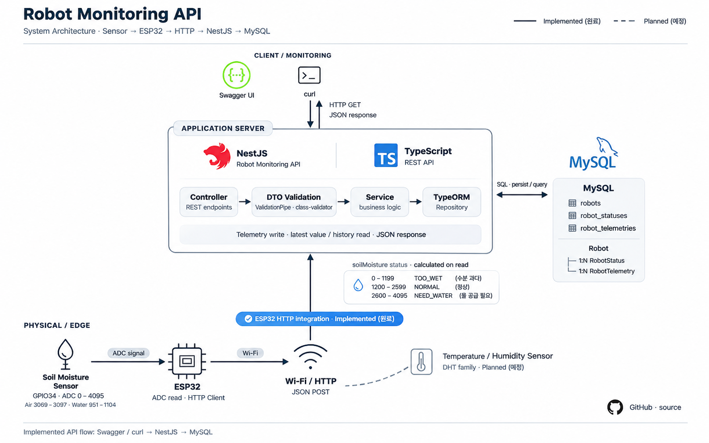

# Robot Monitoring API

ESP32와 센서를 활용하여 실제 센서 데이터를 수집하고,  
NestJS 서버에서 데이터를 저장·조회·판단하는 **디바이스 모니터링 프로젝트**입니다.

단순 REST API 구현에 그치지 않고,

**Sensor → ESP32 → HTTP → NestJS → MySQL**

까지 실제 장치와 서버를 연결하는 과정을 직접 구현하는 것을 목표로 진행했습니다.

---

## 📌 프로젝트 소개

ESP32에 연결된 토양 수분 센서의 ADC 값을 읽어 NestJS 서버로 전송하고,  
서버에서는 데이터를 검증한 뒤 MySQL에 저장합니다.

저장된 Telemetry 데이터는 최신값 및 이력으로 조회할 수 있으며,  
토양 수분 ADC 값을 기준으로 현재 상태를 판단합니다.

### 실제 구현 흐름
`Soil Moisture Sensor → ESP32 → Wi-Fi / HTTP → NestJS → MySQL`

## 🏗 System Architecture

<p align="center">
  
</p>


### 데이터 처리 과정

1. 토양 수분 센서에서 아날로그 값을 측정합니다.
2. ESP32의 GPIO34에서 ADC 값을 읽습니다.
3. ESP32가 Wi-Fi를 통해 NestJS API로 JSON 데이터를 전송합니다.
4. NestJS의 DTO와 `ValidationPipe`를 통해 요청 데이터를 검증합니다.
5. Service에서 Robot과 Telemetry 데이터를 연결합니다.
6. TypeORM을 통해 MySQL에 데이터를 저장합니다.
7. 최신값 및 이력 API를 통해 저장된 데이터를 조회합니다.
8. 조회 시 토양 수분 값을 기반으로 현재 상태를 계산합니다.

---

## ✨ 주요 기능

### Robot 관리

- Robot 생성
- Robot 목록 조회
- Robot 단건 조회

### Robot Status 관리

- Robot 상태 및 배터리 정보 저장
- 최신 상태 조회
- 상태 이력 조회
- 배터리 값 `0 ~ 100` 검증

### Telemetry 관리

- Telemetry 데이터 저장
- 최신 Telemetry 조회
- Telemetry 이력 조회
- 조회 개수 `limit` 지원
- 최신순 정렬
- 토양 수분 상태 자동 판단

### ESP32 실제 연동

- ESP32 Station Mode Wi-Fi 연결
- GPIO34에서 토양 수분 ADC 값 수집
- JSON 데이터 생성
- NestJS Telemetry API로 HTTP POST
- Serial Monitor에서 요청 및 응답 확인

---

## 🌱 토양 수분 상태 판단

ESP32 ADC 범위 `0 ~ 4095`를 기준으로 프로젝트 내부 상태 판단 규칙을 정의했습니다.

| ADC 값 | 상태 | 의미 |
|---|---|---|
| `0 ~ 1199` | `TOO_WET` | 수분이 많은 상태 |
| `1200 ~ 2599` | `NORMAL` | 정상 범위 |
| `2600 ~ 4095` | `NEED_WATER` | 수분이 부족한 상태 |
| `< 0`, `> 4095` | `SENSOR_ERROR` | 센서 값 오류 |

> 해당 임계값은 실제 식물 재배를 위한 과학적 기준이 아니라, 센서 측정값을 기반으로 프로젝트에서 정의한 판단 기준입니다.

실제 센서 테스트에서는 대략 다음 값이 측정되었습니다.

```text
공기 중: 약 3069 ~ 3097
물에 직접 넣었을 때: 약 951 ~ 1104
```

센서 특성상 값이 클수록 건조하고, 값이 작을수록 습한 방향으로 측정되었습니다.

---

## 🔌 실제 ESP32 연동

ESP32에서는 토양 수분 센서를 GPIO34에 연결합니다.

```cpp
const int SOIL_PIN = 34;

int soilValue = analogRead(SOIL_PIN);
```

측정된 값을 다음 형태의 JSON으로 서버에 전송합니다.

```json
{
  "temperature": 24.8,
  "humidity": 55.3,
  "soilMoisture": 1723
}
```

현재 실제 센서에서 수집되는 값은 `soilMoisture`입니다.

`temperature`, `humidity`는 향후 온습도 센서 확장을 고려하여 데이터 구조에 포함한 고정 예시값이며, 현재 실제 센서 측정값은 아닙니다.

---

## ✅ 실제 연동 테스트

실제 ESP32와 토양 수분 센서를 사용하여 전체 데이터 흐름을 확인했습니다.

```text
Soil Moisture Sensor
→ ESP32
→ Wi-Fi
→ HTTP POST
→ NestJS
→ MySQL
```

### ESP32 측정

```text
Soil value: 1723
```

### 요청 데이터

```json
{
  "temperature": 24.8,
  "humidity": 55.3,
  "soilMoisture": 1723
}
```

### 서버 응답

```text
HTTP Response code: 201
```

### MySQL 저장 결과

```text
id            : 5
robot         : robot-db-01
temperature   : 24.8
humidity      : 55.3
soilMoisture  : 1723
robot_id      : 1
```

ADC 값 `1723`은 현재 프로젝트의 상태 판단 기준에서 `NORMAL` 범위에 해당합니다.

이를 통해 실제 센서에서 측정한 값이 서버를 거쳐 데이터베이스까지 저장되는 것을 확인했습니다.

---

## 🛠 Tech Stack

### Backend

- TypeScript
- NestJS
- TypeORM
- class-validator
- class-transformer
- Swagger

### Database

- MySQL

### Embedded

- ESP32
- Arduino Framework
- Wi-Fi
- HTTPClient
- Analog Sensor Input

### Development

- Node.js
- npm
- Git / GitHub

---

## 📡 API

### Robot

| Method | Endpoint | 설명 |
|---|---|---|
| `POST` | `/robots` | Robot 생성 |
| `GET` | `/robots` | Robot 목록 조회 |
| `GET` | `/robots/:id` | Robot 단건 조회 |

### Robot Status

| Method | Endpoint | 설명 |
|---|---|---|
| `POST` | `/robots/:id/status` | Robot 상태 저장 |
| `GET` | `/robots/:id/status` | 최신 상태 조회 |
| `GET` | `/robots/:id/history?limit=10` | 상태 이력 조회 |

### Telemetry

| Method | Endpoint | 설명 |
|---|---|---|
| `POST` | `/robots/:id/telemetry` | Telemetry 저장 |
| `GET` | `/robots/:id/telemetry/latest` | 최신 Telemetry 조회 |
| `GET` | `/robots/:id/telemetry/history?limit=10` | Telemetry 이력 조회 |

---

## 📖 Swagger

서버 실행 후 아래 경로에서 API를 확인할 수 있습니다.

```text
http://localhost:3000/api
```

Swagger를 통해 Robot 및 Telemetry API를 직접 호출하고 응답을 확인할 수 있습니다.

---

## 📂 프로젝트 구조

```text
robot-monitoring-api/
├── esp32/
│   └── smart_plant/
│       └── smart_plant.ino
│
├── src/
│   ├── robots/
│   │   ├── dto/
│   │   ├── entities/
│   │   ├── utils/
│   │   │   └── soil-moisture-status.util.ts
│   │   ├── robots.controller.ts
│   │   ├── robots.service.ts
│   │   └── robots.module.ts
│   │
│   ├── app.module.ts
│   └── main.ts
│
├── package.json
└── README.md
```

---

## ⚙️ 실행 방법

### 1. Repository Clone

```bash
git clone https://github.com/jghtop0/robot-monitoring-api.git
cd robot-monitoring-api
```

### 2. Dependency 설치

```bash
npm install
```

### 3. MySQL Database 생성

```sql
CREATE DATABASE robot_monitoring;
```

### 4. 환경변수 설정

프로젝트 루트에 `.env` 파일을 생성합니다.

```env
DB_HOST=localhost
DB_PORT=3306
DB_USERNAME=YOUR_DB_USERNAME
DB_PASSWORD=YOUR_DB_PASSWORD
DB_DATABASE=robot_monitoring
```

`.env`에는 데이터베이스 계정 정보가 포함되므로 Git에 커밋하지 않습니다.

### 5. NestJS 실행

```bash
npm run start:dev
```

기본 서버 포트:

```text
3000
```

---

## 🔧 ESP32 설정

ESP32 코드:

```text
esp32/smart_plant/smart_plant.ino
```

실행 전에 다음 값을 자신의 환경에 맞게 수정합니다.

```cpp
const char* ssid = "YOUR_WIFI_NAME";
const char* password = "YOUR_WIFI_PASSWORD";

const char* serverUrl =
  "http://YOUR_SERVER_IP:3000/robots/1/telemetry";
```

ESP32와 NestJS 서버가 서로 접근 가능한 동일 네트워크에 있어야 합니다.

로컬 IP는 네트워크 환경에 따라 변경될 수 있으므로 실행 전에 서버의 현재 IP를 확인해야 합니다.

---

## 🔐 Validation

NestJS의 Global `ValidationPipe`를 적용했습니다.

```typescript
new ValidationPipe({
  whitelist: true,
  transform: true,
});
```

이를 통해 DTO에 정의되지 않은 필드를 제거하고 요청 데이터를 검증합니다.

예를 들어 Robot Status의 배터리 값은 `0 ~ 100` 범위만 허용합니다.

---

## 💡 구현 과정에서 배운 점

### 1. TypeScript 타입과 Runtime Validation의 차이

TypeScript 타입 선언만으로는 실제 HTTP 요청 데이터가 검증되지 않는다는 점을 확인했습니다.

`class-validator`와 NestJS의 `ValidationPipe`를 사용하여 런타임 요청 검증을 적용했습니다.

### 2. Entity와 Database Schema의 일관성

DTO, Entity, 실제 MySQL Schema가 서로 다르면 컴파일이 성공하더라도 런타임에서 데이터 저장 오류가 발생할 수 있다는 점을 경험했습니다.

각 계층의 데이터 구조를 일치시키는 것이 중요하다는 것을 확인했습니다.

### 3. 실제 장치와 서버의 네트워크 연결

ESP32와 서버를 실제로 연결하는 과정에서 로컬 IP 변경으로 HTTP 연결이 실패하는 문제를 경험했습니다.

서버를 외부 인터페이스에서 접근할 수 있도록 설정하고, 현재 LAN IP를 확인하면서 네트워크 통신 과정을 이해했습니다.

### 4. 센서 데이터와 서버 로직의 분리

ESP32는 센서값을 수집하고 전송하는 역할에 집중하고, 상태 판단은 서버에서 수행하도록 구성했습니다.

이를 통해 센서 데이터 수집과 비즈니스 로직을 분리했습니다.

---

## 🚧 현재 구현 범위

### 구현 완료

- Robot CRUD 기본 기능
- Robot Status 저장 및 조회
- Telemetry 저장 및 조회
- DTO Validation
- MySQL 연동
- Swagger
- 토양 수분 상태 판단
- 실제 토양 수분 센서 연동
- ESP32 → NestJS HTTP 통신
- 실제 센서 데이터 MySQL 저장

### 향후 개선

- 실제 온습도 센서 연동
- 주기적인 Telemetry 전송
- 실시간 모니터링 Dashboard
- WebSocket 기반 실시간 데이터 전달
- Docker 기반 실행 환경 구성
- 배포 환경 구성
- 센서별 임계값 Calibration 개선

---

## 🎯 프로젝트 목표

이 프로젝트는 단순히 API를 만드는 것이 아니라,

**실제 장치에서 발생한 데이터를 서버로 전달하고, 서버에서 처리·저장·조회하는 전체 흐름을 직접 경험하는 것**

을 목표로 진행했습니다.

ESP32와 NestJS를 연결하면서 디바이스와 백엔드 사이의 HTTP 통신, 데이터 검증, 영속화, 상태 판단 과정까지 구현했습니다.
